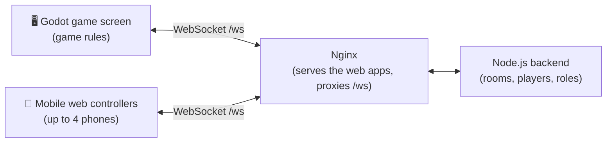

# Red Planet Survivors

**A cooperative Mars survival game built for NASA Hackathon 2026.**

Players work together to keep a Mars base alive for 20 Sols. One shared Godot game screen presents the mission, while up to four players use their phones to join a room, choose roles and vote on decisions.

[](LICENSE)
[](https://nodejs.org/)

> **Project:** Red Planet Survivors<br>
> **Event:** NASA Hackathon 2026<br>
> **Audience:** children aged 7–12 (simple English)<br>
> **Status:** Submitted

| ▶ [**Play it online**](https://red-planet-survivors.karu.es/) | 🎬 [**Promo video (20 s)**](docs/assets/promo-video.mp4) | 📄 [**Proposal**](docs/proposal/proposal-en.pdf) ([ES](docs/proposal/proposal-es.pdf)) | 📚 [**Documentation**](docs/README_EN.md) ([ES](docs/README_ES.md)) |
|---|---|---|---|

This is an independent hackathon project and is not an official NASA product or affiliated with or endorsed by NASA.

## Try it in two minutes

The game is running on a team member's server: <https://red-planet-survivors.karu.es/>

1. On a computer (ideally a projector or big screen), open the link and press **Play → Create a game**.
2. In the game, press **Start Game** and choose **Play solo** to play with the mouse, or **Play multiplayer** to get a room code and a QR code.
3. Each player scans the QR code (or opens the same address and types the code) on their phone, picks a job and votes every Sol.

## At a glance

- **Cooperative gameplay:** discuss trade-offs and protect the crew, oxygen, energy and base integrity.
- **Flexible player count:** play solo or with 1–4 mobile controllers.
- **Real NASA science:** most events are based on a real NASA mission or finding, and a solar-storm event is triggered by live NASA data.
- **Room-based multiplayer:** a Node.js backend keeps game sessions and player identities separate.
- **Web deployment:** play in a browser; Docker Compose and Nginx support local demos and Internet hosting.
- **Offline-ready demo:** game assets are bundled locally, and NASA data features have fallbacks.

## NASA science inside

| Source | How the game uses it |
|---|---|
| **NASA DONKI** (space weather API, live) | At the start of a game, checks for strong (M/X class) solar flares in the last three days. If there is one, the *Solar Storm Alert!* event appears with the flare's real class and date. |
| **NASA Image and Video Library** (live) | Loads a real photo of Jezero Crater for the intro, with its credit. |
| **InSight / SEIS** | The seismic-sensor objective and the warned or surprise *Marsquake!* events. |
| **MOXIE** (Perseverance) | The oxygen-generator objective: build it in three phases to stop losing oxygen. |
| **Perseverance, Curiosity, Spirit, Opportunity** | Landing site, the rover stuck in sand, dust on the solar panels, the greenhouse. |
| **OSDR** (Open Science Data Repository) | Probiotics against radiation and the effects of spaceflight on the brain (health events). |
| **Earth–Mars communication delay** | *Ask Earth for help* is inspired by the real radio delay (several minutes per message): in the game the answer takes 1–2 Sols, and the screen shows a fixed distance of about 225 million km and 12 minutes. |

Each event shows a short *NASA fact* written by the team, and an 18-term **Word Book** explains words like *Sol*, *regolith* or *coronal mass ejection* for children. Live data has local fallbacks, so the game also works without Internet. Details: [data sources](docs/en/overview.md#word-book-and-data-sources).

## How it works



**Authority is deliberately split:** Godot owns game rules, event validation and consequences. Node owns rooms, connections and player roles. A phone sends only an `optionId`; it never calculates game outcomes. Player identity is derived from the registered connection, not trusted from a phone-supplied `playerId`.

## Technology

| Area | Technologies |
|---|---|
| Game | Godot 4.7, GDScript |
| Mobile controller | Vue 3, Vite, Tailwind CSS 4 |
| Landing page | Vue 3, Vite, Tailwind CSS 4 |
| Backend | Node.js 22+, Express, `ws` |
| Hosting | Nginx, Docker Compose; Coolify for the primary Internet deployment |

## Get started

### Requirements

- Node.js **22 or later**
- npm
- Godot 4.7 to run or export the game screen
- Docker Compose for containerized deployment

### Run the development environment

From the repository root:

```bash
npm install
npm run dev
```

This starts the backend, mobile controller and landing page. Open the URL printed in the terminal (normally `http://localhost:5173/`). The host creates a room in Godot; players can then join from phones on the same Wi-Fi using the displayed room code.

The development server serves the most recent Godot export at `/game/`. If port 3000 is unavailable, the backend selects another free port and the web apps are configured to use it.

```bash
npm test       # backend and controller tests
npm run build  # build controller and landing page
```

### Run the game in Godot

Open `game/project.godot` in Godot 4.7. To build the browser version, select **Project → Export → Web** and export to `dist/game/`.

### Run with Docker

Export the Godot project to web before building the image.

```bash
npm run docker:local  # local HTTPS deployment serving dist/game/
npm run docker:dev    # local HTTPS deployment serving dist/game_debug/
```

The local HTTPS certificate is self-signed, so each browser will ask you to accept it on first use. Open the game and controllers using the host PC's **LAN IP address**, not `localhost`. For Internet deployment with Coolify, configure `compose.yaml` and the domain on the `web` service.

## Project layout

```text
game/                  Godot game
game_debug/            Godot connection-testing project
backend/               Node.js room/session server
controller/            Mobile web controller
landing/               Landing page and join/create entry point
deploy/                Nginx and TLS Docker configuration
scripts/               Root development launcher
dist/game/             Committed Godot web export
dist/game_debug/       Committed debug-game web export
docs/README_EN.md      Documentation index in English (README_ES.md in Spanish)
docs/en/, docs/es/     English and Spanish documentation (same structure)
docs/assets/           Images and promo video used by the docs
docs/proposal/         Original hackathon proposal (PDF, English and Spanish)
tools/                 Balance simulator and asset helper scripts
compose*.yaml          Docker Compose deployment configurations
```

## Documentation

Start at the documentation index — **[English](docs/README_EN.md)** · **[Español](docs/README_ES.md)** — or jump straight in:

| | English | Español |
|---|---|---|
| **One-page summary of the game** | [Project overview](docs/en/overview.md) | [Resumen del proyecto](docs/es/resumen.md) |
| Game design and balance | [Game design](docs/en/game-design.md) | [Diseño del juego](docs/es/juego/diseno.md) |
| Message protocol (network source of truth) | [Protocol](docs/en/protocol.md) | [Protocolo](docs/es/protocol.md) |
| Godot game | [Architecture](docs/en/godot/architecture.md) · [Networking](docs/en/godot/networking.md) | [Arquitectura](docs/es/godot/arquitectura.md) · [Red](docs/es/godot/red.md) |
| Web controller and backend | [Controller](docs/en/controller.md) · [Backend](docs/en/backend.md) | [Mando](docs/es/controller.md) · [Backend](docs/es/backend.md) |
| Deployment | [Deployment](docs/en/deploy.md) | [Despliegue](docs/es/deploy.md) |

## License and credits

This project is distributed under the **Apache License 2.0**; see [`LICENSE`](LICENSE). Third-party fonts, images and other assets may have their own terms and attributions. For example, the landing-page Mars image is credited to **ESA/DLR/FU Berlin**, processed by **J. Cowart**. Please retain applicable third-party notices when using or redistributing those materials.

NASA names and mission references are used to identify scientific sources and inspirations; they do not imply NASA endorsement.
