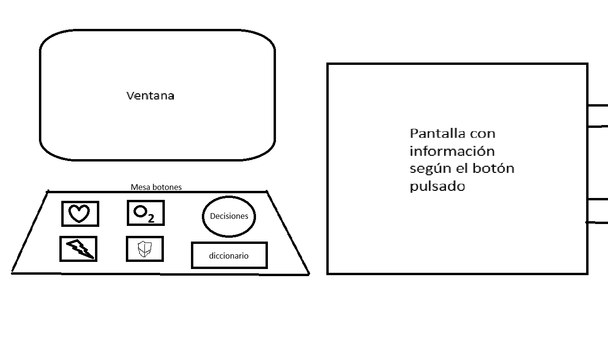

# Game Design: Red Planet Survivors

The rules defined by the team, with the figures used by the submitted version. The event catalog is in [event-catalog.md](event-catalog.md); implementation details for Godot are in [Godot architecture](godot/architecture.md).

> **Source of truth for numbers:** [`game/Data/events.json`](../../game/Data/events.json), which is loaded by the game. This document explains the rules; if a number differs, `events.json` takes precedence and this document should be corrected. Contradictions between the source documents, and how they were resolved, are listed under [Design decisions](#design-decisions).

## Concept

A cooperative educational game for **1–4 players** (or one person with a mouse), in short sessions that fit in a class. The crew lives at a Mars base near Jezero Crater and must survive **20 Martian days** (*Sols*) while completing scientific objectives. Every event is based on a real NASA mission or fact.

- **Main screen (Godot):** displays the event, base resources and outcome.
- **Phones:** each player has a role and chooses options. A physical board with NFC tags can open the controller directly with a role (`/controller/<role>`).
- The game supports **1–4 players**: no mandatory decision may depend on a role that is absent.

### Main-screen sketch



- **Window:** view of the world outside the base.
- **Button desk:** the four resources (health, oxygen, energy, integrity), **Decisions** and **Dictionary** (the [Glossary](#glossary)).
- **Information screen:** details about the selected button.

## Sol loop

Time advances **in turns**: one main event per Sol and no timer, so players can discuss. Only emergencies have a countdown (20 seconds).

```text
SOL START ──► EVENT SELECTION ──► DECISION ──► RESOLUTION ──► SOL END ──┐
     ▲                                                                  │
     └──────────────────── (if the game continues) ────────────────────┘
```

| Phase | What happens |
|---|---|
| **Sol start** | Advance the Sol counter. Automatic resource changes (see [Balancing](#difficulty-balance)): Oxygen −3 until MOXIE is complete, Energy +7 (+6 from Sol 8), Base Integrity −2 and, from Sol 4, Health −4. Apply persistent-event and scheduled effects due today. The space-weather API is queried once, when the game starts; a flare triggers the [real-time event](#real-time-solar-alert). |
| **Event selection** | Choose a valid event based on its conditions (objective chains or random events). Unlock its terms in the [Glossary](#glossary). |
| **Decision** | Show title, description, NASA fact and options. Players vote or the assigned role chooses. Players may [ask Earth for help](#ask-earth-for-help). |
| **Resolution** | Apply immediate effects, schedule delayed effects and show the outcome text. |
| **Sol end** | Check for defeat (any resource at 0) and victory (the final Sol). |

## Roles

| Role (code ID) | Display name | Specialties (based on events) |
|---|---|---|
| `engineer` | Engineer | Hardware, panels, rover, sensors and MOXIE; the most role-specific options. |
| `biologist` | Biologist | Greenhouse, crops and probiotics. |
| `doctor` | Doctor | Health, first aid and stress. |
| `generalist` | Generalist | Can take part in general decisions and tasks like any other role. |

The English IDs are used by the [message contract](protocol.md) and `events.json`. Event options are either:

- **General vote** (`role: null`): everyone present may vote.
- **Role option** (`role: "engineer"`…): that role carries it out (and is the one who becomes busy), but **anyone can vote for it**. It is blocked while that role is away from the base. Each event has at least one general-vote option so play can always continue.

## Base resources

Four bars range from 0 to 100 and start at 80. **If any reaches 0, the game is lost.**

| Resource | ID | Notes |
|---|---|---|
| Energy | `energy` | Batteries and solar panels. Gains **+7 per Sol** (+6 from Sol 8, when dust covers the panels). |
| Oxygen | `oxygen` | Passively loses **3 per Sol** until MOXIE is complete. |
| Integrity | `integrity` | Condition of the base structure and equipment. |
| Health | `health` | Crew health. Extra goal: always keep it above 50. |

### Difficulty balance

Bars change not only because of player choices: each is under **automatic pressure at dawn**, so defeat is not caused by oxygen alone. Values are `GameState` constants (`PASSIVE_*`, `*_FROM_SOL`); MOXIE event weighting is configured by `weight` in `events.json` (MOXIE events have weight **2**, versus 1 when selecting between objectives).

| Bar | Change each Sol | Reason |
|---|---|---|
| Oxygen | −3 until MOXIE reaches 100% | Breathing; the game's race against time. |
| Energy | +7 (+6 from Sol 8) | Dust accumulates on solar panels. |
| Base Integrity | −2 | Wind and dust wear down the walls. |
| Health | −4 from Sol 4 | Stress and radiation; the crew starts rested. |

With the earlier rules (Oxygen −5 and no other automatic changes), an attentive player lost every game to oxygen: 95 points lost over 20 Sols against 80 starting points. Health and Integrity were never lethal.

The simulator `tools/balance_sim.py` repeats the game rules and can be run with `python tools/balance_sim.py`. It models an **attentive** player (checks costs and goals and protects the lowest bar) and a **random** player. A real person falls between them.

| Player | Wins | Oxygen losses | Energy losses | Health losses | Integrity losses |
|---|---:|---:|---:|---:|---:|
| Attentive, before | 41% | 59% | 0% | 0% | 0% |
| Attentive, current | 72% | 10% | 18% | 0% | 1% |
| Random, before | 6% | 94% | 0% | 0% | 0% |
| Random, current | 21% | 57% | 5% | 15% | 3% |

“Current” figures are for the submitted version (3,000 games per row). The final tuning softened the daily pressure (Oxygen −3 instead of −4, Base Integrity −2 instead of −3 and Health −4 instead of −6), so the game is more forgiving: a careful player wins most games and, when they lose, it is usually through Energy or Oxygen; random choices still lose mostly through Oxygen and Health. MOXIE is completed in 90% of attentive games (previously 51%).

To adjust difficulty: increasing `PASSIVE_OXYGEN_LOSS` or lowering MOXIE's weight makes the game harder and shifts losses toward Oxygen; `PASSIVE_HEALTH_LOSS` and `HEALTH_LOSS_FROM_SOL` are very sensitive; lowering `PASSIVE_ENERGY_GAIN` pressures Energy. Re-run `tools/balance_sim.py` after changes (its `Cfg` class copies the constants: if you change them in `game_state.gd`, change them there too).

## End screens; victory and defeat

The themed `EndScreen` (`game/Scripts/end_screen.gd`) shows a blue button frame, pixel-art title and rocket/Mars, four crew helmets, objective results, score and discovered words, plus *Play again* and *Back to menu* buttons.

- **Victory (“Mission complete!”):** gold title, upright rocket with a lit engine, glowing Mars, colorful helmets and confetti; `success` sound.
- **Defeat (“Mission failed!”):** gently pulsing red screen, fallen rocket by a dark Mars, gray helmets and the depleted resource icon; `failure` sound.
- **Defeat:** any resource reaches 0.
- **Victory:** survive until Sol **20** (`GameState.MAX_SOLS`).
- **Score:** 200 points per completed objective + the average of the four bars (`GameState.compute_score`).

## Objectives

| Objective | Requirement | Reward | State in `GameState` |
|---|---|---|---|
| **Seismic sensor network** (InSight mission) | Build and place 3 sensors. | If placed before **Sol 13** (`SEISMIC_DEADLINE_SOL`), the quake comes with a warning. | `sensors_placed` |
| **MOXIE oxygen generator** | Complete assembly phases to 100%. | Stops passive Oxygen loss. | `moxie_progress` |
| **Healthy crew** | Keep Health above 50% for the whole game. | Counts toward score. | `health_always_above_goal` |
| **Stable colony** | Successfully grow 3 crops. | Counts toward score. | `harvests_completed` |
| **Rover rescue** | Free the rover trapped in the dunes. Inspired by Spirit, trapped in soft sand in 2009. | Counts toward score. | `rover_rescued` (`rover-stuck` event) |

## Event mechanics

| Mechanic | Example | `events.json` field |
|---|---|---|
| Immediate effects | Energy −15, Oxygen +10 | `effects` |
| Delayed effects | Eat sprouts: Oxygen −10 next Sol | `delayed` |
| Multi-Sol problem | Dust storm: Energy −10 for 2 Sols | `start_condition` (`daily` or `sequence`) |
| Extra chance | 50% chance of finding a special rock (+10 Energy) | `chance` |
| Objective progress | MOXIE to 33%, +1 harvest | `set`, `add` |
| Failure penalty | The repair fails: Base Integrity −10 | `on_fail` |
| Retry | Rover, sensors and MOXIE come back after a failure | `retry_on_fail` |
| Chained events | Duct-tape sensors trigger “The dusty sensor” 1–2 Sols later | `schedule_event` |
| Effect on appearance | Unwarned quake: Base Integrity −20 before deciding | `on_start` |
| Countdown | Quakes: 20 s | `timer_seconds`, `timeout_option` |
| Busy crew | The Engineer is busy for 2 Sols | `away_sols`, `away_all` |
| Selection weight | MOXIE events appear twice as often among objectives | `weight` |

## Crew away from the base

Each option keeps its actor busy for 0, 1 or 2 Sols (`away_sols` in `events.json`). Durations by option are listed in [crew availability](crew-availability.md).

- A role-specific option occupies that astronaut for `away_sols` Sols. If it is 1 Sol, they are unavailable tomorrow and return the following day.
- A group option (“everyone” with `away_sols`) occupies the whole crew, leaving the base empty. It can only be chosen if all four are at the base. “Two walks” occupies nobody today but makes the whole crew busy tomorrow (`away_all` in the delayed effect).
- Busy astronauts cannot participate; their role options are disabled and their phone shows “You are busy!”.
- **Empty base:** if all four are busy at the start of a Sol, no event is generated. Normal daily consumption applies and a message explains that the day passes.
- Astronauts return on the specified Sol, announced at dawn with a door sound.
- The cabin's lower-right strip shows four helmets: colored and “READY” at base; gray and “BUSY - N Sols” while away.

## Event reading and presentation

The event description is typed out at 23 characters per second (2.5–12 seconds; current events take 3.3–8.6 seconds, about 5.8 seconds on average). Players cannot decide until it finishes: options appear after the text in solo mode; phones show “Read the story!” until then; Earth help is also unavailable. NASA facts and Earth's hint appear afterward. Critical-event countdowns (quakes) start **after** the reading. Constants are in `TurnManager` (`READING_CHARS_PER_SECOND`, `READING_MIN_SECONDS`, `READING_MAX_SECONDS`). A voting tie-break does not repeat the reading. `Texting_SFX` loops during reading and fades out when reading ends, the event resolves or the game ends.

The tutorial has six illustrated pages: welcome, the four bars and daily changes, reading/choosing/voting, jobs and busy crew, tools (Earth help, glossary and menu), and objectives. Content is in `intro.gd` (`PAGES`: `title`, BBCode `body` and `images` with `paths`, `caption`, `max` and `pixel`). Update text and screenshots when mechanics or UI change. Tutorial pages type at 55 characters per second (1.5–10 seconds); pressing *Next* while typing reveals the rest, and the next press advances.

Dawn updates (“the Engineer returned”, “Oxygen dropped by 3”…) no longer appear over the event: changes appear on the bars and in their history, while crew availability appears in the avatars.

## What appears where

| Location | Content |
|---|---|
| Godot's right-hand screen | Event title, description, NASA fact, Earth hint and decision result. In multiplayer, options are on phones; in solo mode, they appear below the event and are selected with the mouse. |
| Each player's phone | **All** event options, including those assigned to other roles. Role options show their role and costs; disabled options explain why. |

**MENU and Word Book.** The gray plate at the cabin's upper-right has a **MENU** button. It overlays the whole right screen (including Sol and objective headers) with **Options** (sound controls) and **Exit** (leave the game and return to the main menu; in multiplayer this also closes the room). A blue **X** or MENU closes the overlay. **WORD BOOK** shows discovered terms; new entries are highlighted with “NEW!”. Opening the menu does not pause the game, and a new event closes it.

**Start Game** offers **solo** (one screen, no phones or network; choose with the mouse) or **multiplayer** (lobby, phones and voting). In solo mode, `TurnManager.submit_choice` applies the choice directly without voting.

The `Phone (debug)` simulator is hidden: solo options are shown on screen, and multiplayer uses real phones (its code remains in `main_ui.gd`). The `Flare (debug)` button, which simulates a solar alert, only appears when running from the Godot editor (not on the published web build). `TurnManager.controller_view_for(role)` prepares each controller view, and `submit_choice_from(role, eventId, optionId)` validates it. Options may include `detail`, `disabled` and `reason` as specified in `protocol.md`; real phones are handled by `PhoneBridge` (see [Godot networking](godot/networking.md)).

## Ask Earth for help

This mechanic is based on real communication delays: 4–24 minutes per message between Mars and Earth, depending on distance.

- Available for any unresolved event. The radio recharges every **4 Sols** (`GameState.EARTH_HELP_COOLDOWN_SOLS`), allowing at most five requests in a 20-Sol game. Four was chosen instead of three so it remains a valuable hint rather than a daily button.
- The event is put **on hold**, the game moves to the next Sol and the event returns when the reply arrives. Persistent events keep applying their penalties while waiting.
- The reply brings a **Mission Control hint** (`earth_hint` in `events.json`).
- Two ways to ask (`TurnManager.EARTH_HELP_OPTIONS`): **Full report** (told by the Commander, −5 Energy, reply in **1 Sol**) and **Quick message** (free, reply in **2 Sols**). *Cancel* closes the window to decide without help.
- **Distance:** the game shows a fixed value, 225 million km and 12 minutes of signal delay. Querying the day's distance from JPL Horizons is planned but not connected.
- Earth help is unavailable during a solar alert.

## Real-time solar alert

- At the start of a game, query NASA DONKI for solar flares from the previous three days.
- An M- or X-class flare interrupts the turn with a special event showing the real date.
- During that Sol and the next, Earth help is unavailable and radiation increases. The crew can be protected with probiotics (Biologist), shields (Engineer) or the general `shelter` option.
- When running from the Godot editor, the `Flare (debug)` button simulates a flare without relying on the API. It is hidden on the published web build.

## Glossary

The educational glossary unlocks technical terms (Sol, MOXIE, Jezero Crater, regolith, coronal mass ejection, probiotics…) when their events appear. Players can view a simple definition and a NASA fact without pausing the game. New terms trigger a notification (“New word added to the Word Book: …”).

The Word Book displays one pixel-art tile per word (`game/Images/Glossary/<term-id>.png`, 32×32). Unknown words are dimmed with a “?”; unseen new words have an orange border. The details panel shows the illustration, title, explanation and NASA fact, with a discovered/total counter. Icons are generated by `tools/make_glossary_icons.py`; add a drawing there and regenerate icons when adding a term to `glossary.json`.

## NASA APIs

Only the following NASA APIs are queried by the current game. Requests run directly from Godot, not the web controller or Node backend; the demo remains playable offline.

| Active API | Where it is used | Purpose and offline fallback |
|---|---|---|
| [NASA DONKI](https://api.nasa.gov/) (`/DONKI/FLR`) | `game/Scripts/turn_manager.gd`, when a game starts | Checks flares from the previous three days. An M/X flare triggers Solar Storm Alert with its real class and date. Offline or on request failure, no live alert is triggered; the debug button can simulate one. Uses `DEMO_KEY` (low quota). |
| [NASA Image and Video Library](https://images-api.nasa.gov/search?q=jezero%20crater&media_type=image) | Requested by `game/Scripts/nasa_api.gd` at startup; displayed by `game/Scripts/intro.gd` | Loads a Jezero image and its title for the intro background and credit. If unavailable, the local ESA Mars Express image is used. |

Both requests use a 3-second timeout. The image library request does not require the DONKI API key.

### Planned NASA API integrations (not currently queried)

| API | Planned use | Current behavior |
|---|---|---|
| [JPL Horizons](https://ssd.jpl.nasa.gov/api/horizons.api) | Earth–Mars distance and radio delay for Earth help | Fixed design values: 225 million km and 12 minutes |
| [Mars Rover Photos](https://api.nasa.gov/) | Perseverance photos for the intro or rover event | Local art; no API request |
| InSight Weather / MEDA | Wind bonus in “Dust on the Solar Panels” | No bonus from live weather data |

## Design decisions

Converting the source PDFs to Markdown revealed contradictions between them. Sources compared: the “Godot Classes” PDF, the “Events / Games” PDF and the former `docs/especificaciones.md` (in Git history). This is how the submitted version resolves them:

| Topic | What the sources said | Decision |
|---|---|---|
| Game length | 15 Sols (classes), 20 (specifications), 30 (events) | **20 Sols** (`GameState.MAX_SOLS`) |
| Additional ability | Commander, granted to the first player on top of their role | Yes: the first player to join is Commander and their vote breaks a second tie |
| Health | One shared bar or one per astronaut | **One shared bar** (`health`) |
| MOXIE phases | Four phases of 25% or three of 33% | **Three phases** (33 + 33 + 34) |
| Sensor deadline | Before Sol 20 or Sol 13 | **Sol 13** (`SEISMIC_DEADLINE_SOL`) |
| Earth-help reward | Reveal best option, give a hint or remove an option | **A hint** (`earth_hint`) |
| Help delay | 2–3 Sols or 1–2 Sols | **1 Sol** (full report) or **2 Sols** (quick message) |
| Role skill chance/cost | Only in the classes PDF | Dropped: each option has its own `success_chance` and role |
| Health, colony and rover objectives | In the design | **Implemented**: they count toward the score |
| Victory condition | 3 of 4 objectives, or score by objectives | **Survive 20 Sols**; objectives add points |
| Rover location | Jezero Crater or Rocknest dunes (Gale Crater) | **Jezero Crater** (the dunes of Jezero) |
