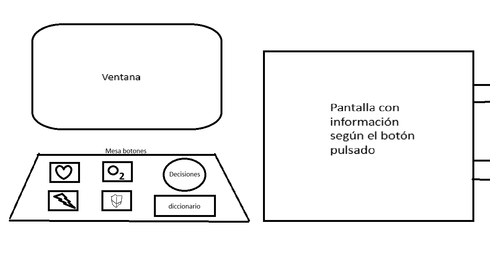

# Diseño del juego: Red Planet Survivors

Reglas del juego tal y como las ha definido el equipo, con las cifras que usa la versión entregada. El catálogo de eventos está en [eventos.md](eventos.md) y cómo se implementa en Godot, en [../godot/arquitectura.md](../godot/arquitectura.md).

> **Dónde están las cifras de verdad:** en [`game/Data/events.json`](../../../game/Data/events.json), que es lo que carga el juego. Este documento explica las reglas; si un número no coincide, manda `events.json` (y hay que corregir aquí). Las contradicciones entre los documentos de partida y cómo se resolvieron están en [Decisiones de diseño](#decisiones-de-diseño).

## Idea

Juego cooperativo y educativo para **1 a 4 jugadores** (o una sola persona con el ratón), en partidas cortas que caben en una clase. La tripulación vive en una base en Marte, cerca del cráter Jezero, y tiene que sobrevivir **20 días marcianos** (*Sols*) mientras completa objetivos científicos. Cada evento se basa en una misión o un dato real de la NASA.

- **Pantalla principal (Godot):** muestra el evento, los recursos de la base y el resultado.
- **Móviles:** cada jugador tiene un rol y elige opciones. Un tablero físico con etiquetas NFC puede abrir el mando directamente con un rol (`/controller/<rol>`).
- Se puede jugar con **1 a 4 jugadores**: nunca puede quedar bloqueada una decisión por un rol que no está.

### Boceto de la pantalla principal



- **Ventana**: la vista del exterior de la base.
- **Mesa de botones**: los cuatro recursos (salud, oxígeno, energía, integridad), **Decisiones** y **Diccionario** (el [Libro de tecnicismos](#libro-de-tecnicismos)).
- **Pantalla de información**: muestra el detalle del botón pulsado.

## Bucle de un Sol

El tiempo avanza **por turnos**: un evento principal por Sol y sin reloj, para que haya debate. Solo las emergencias tienen cuenta atrás (20 s).

```text
INICIO DEL SOL ──► SELECCIÓN DEL EVENTO ──► DECISIÓN ──► RESOLUCIÓN ──► FIN DEL SOL ──┐
      ▲                                                                              │
      └──────────────────────────────── (si la partida sigue) ───────────────────────┘
```

| Fase | Qué pasa |
|---|---|
| **Inicio del Sol** | Avanza el contador de Sol. Cambios automáticos de las barras (ver [Equilibrio](#equilibrio-de-la-dificultad)): Oxígeno −3 (hasta completar MOXIE), Energía +7 (+6 desde el Sol 8), Fuerza de la base −2 y, desde el Sol 4, Salud −4. Se aplican los efectos de eventos persistentes y los efectos diferidos que tocan hoy. La API de clima espacial se consulta una vez, al empezar la partida: si hay llamarada, salta el [evento en tiempo real](#evento-en-tiempo-real-alerta-solar). |
| **Selección del evento** | Se elige un evento válido según sus condiciones (cadenas de objetivos o aleatorios). Se desbloquean sus términos en el [Libro de tecnicismos](#libro-de-tecnicismos). |
| **Decisión** | Se muestran título, descripción, dato NASA y opciones. Los jugadores votan o decide el rol indicado. Se puede [pedir ayuda a la Tierra](#pedir-ayuda-a-la-tierra). |
| **Resolución** | Se aplican los efectos inmediatos, se programan los diferidos y se muestra el texto de resultado. |
| **Fin del Sol** | Se comprueba la derrota (algún recurso a 0) y la victoria (último Sol). |

## Roles

| Rol (id en el código) | Nombre en pantalla | En qué destaca (según los eventos) |
|---|---|---|
| `engineer` | Engineer (ingeniero) | Hardware, paneles, rover, sensores, MOXIE. Es el rol con más opciones propias. |
| `biologist` | Biologist (bióloga) | Invernadero, cultivos, probióticos. |
| `doctor` | Doctor (médico) | Salud, botiquín, estrés. |
| `generalist` | Generalist (polivalente; en algunos textos, el Comandante) | Puede participar en decisiones y tareas generales como cualquier otro rol. |

Los ids en inglés son los del [contrato de mensajes](../protocol.md) y los de `events.json`. Cada opción de un evento es de dos tipos:

- **Votación general** (`role: null`): votan todos los presentes.
- **Opción de rol** (`role: "engineer"`…): la lleva a cabo ese rol (y es quien queda ocupado), pero **la puede votar cualquiera**. Sale bloqueada mientras ese rol está fuera de la base. Todo evento tiene al menos una opción de votación general, para que siempre se pueda avanzar.

## Recursos de la base

Cuatro barras de 0 a 100. Empiezan en 80. **Si cualquiera llega a 0, se pierde la partida.**

| Recurso | Id | Notas |
|---|---|---|
| Energía | `energy` | Baterías y paneles solares. Gana **+7 por Sol** (+6 desde el Sol 8, cuando el polvo cubre los paneles). |
| Oxígeno | `oxygen` | Pierde **3 por Sol** de forma pasiva hasta que MOXIE está terminado. |
| Integridad | `integrity` | Estado de la estructura y los equipos. |
| Salud | `health` | Salud de la tripulación. Objetivo extra: mantenerla siempre por encima de 50. |

### Equilibrio de la dificultad

Las barras no solo cambian por las decisiones: cada una tiene una **presión automática** al amanecer, para que las derrotas se repartan entre las cuatro y no solo por oxígeno. Las cifras son constantes de `GameState` (`PASSIVE_*`, `*_FROM_SOL`) y el peso de los eventos de MOXIE es el campo `weight` de `events.json` (los eventos de MOXIE pesan **2** frente a 1 al elegir entre objetivos).

| Barra | Qué pasa cada Sol | Por qué |
|---|---|---|
| Oxígeno | −3, hasta que MOXIE está al 100 % | Respirar. Es la carrera contra el reloj del juego. |
| Energía | +7 (+6 desde el Sol 8) | Paneles solares que se llenan de polvo. |
| Fuerza de la base | −2 | El viento y el polvo desgastan los muros. |
| Salud | −4 desde el Sol 4 | Estrés y radiación; los primeros Sols la tripulación está descansada. |

**Por qué se cambió:** con las reglas anteriores (oxígeno −5 y nada más), un jugador atento perdía el 100 % de sus derrotas por oxígeno: 95 puntos de pérdida en 20 Sols contra 80 de partida, así que o se terminaba MOXIE a tiempo o se perdía. Salud e integridad no mataban nunca.

**Cómo se midió:** el simulador `tools/balance_sim.py` repite las reglas del juego (se comprobó que el juego real y el simulador reparten las derrotas igual) y se ejecuta con `python tools/balance_sim.py`. Hay dos jugadores simulados: el **atento** (mira costes y objetivos y protege la barra más baja) y el **al azar**. Una persona real está entre los dos.

| Jugador | Gana | Pierde por oxígeno | energía | salud | integridad |
|---|---|---|---|---|---|
| Atento, antes | 41 % | 59 % | 0 % | 0 % | 0 % |
| Atento, ahora | 72 % | 10 % | 18 % | 0 % | 1 % |
| Al azar, antes | 6 % | 94 % | 0 % | 0 % | 0 % |
| Al azar, ahora | 21 % | 57 % | 5 % | 15 % | 3 % |

Las cifras de «ahora» son las de la versión entregada (3000 partidas por fila). En los últimos retoques se suavizó la presión diaria (oxígeno −3 en vez de −4, base −2 en vez de −3 y salud −4 en vez de −6), así que la partida es más asequible: quien juega con cuidado gana casi siempre y, si pierde, suele ser por energía u oxígeno; quien elige sin pensar sigue perdiendo sobre todo por oxígeno y salud. MOXIE se completa en el 90 % de las partidas atentas (antes el 51 %).

**Cómo retocarlo:** subir `PASSIVE_OXYGEN_LOSS` o bajar el peso de MOXIE endurece la partida y la carga hacia el oxígeno; `PASSIVE_HEALTH_LOSS` y `HEALTH_LOSS_FROM_SOL` son muy sensibles (pasar de −5 a −6 multiplica por 3 las derrotas por salud); bajar `PASSIVE_ENERGY_GAIN` carga la energía. Tras cambiar algo, repetir `tools/balance_sim.py`, que usa las mismas constantes (están copiadas en su clase `Cfg`: si se cambian en `game_state.gd`, hay que cambiarlas también allí).

## Pantallas de final

Al acabar la partida sale una pantalla con la temática del juego (`EndScreen`, `game/Scripts/end_screen.gd`): marco azul de los botones, título pixelado, el cohete y Marte en pixel art, los cuatro cascos de la tripulación y los objetivos con su marca (tick verde si se cumplió), la puntuación y las palabras descubiertas. Dos botones azules: *Play again* y *Back to menu*.

- **Victoria («Mission complete!»):** título dorado, cohete de pie con la llama encendida junto a un Marte que brilla, cascos de colores y confeti. Suena `success`.
- **Derrota («Mission failed!»):** pantalla roja que late suave, cohete caído junto a un Marte apagado, cascos grises y el icono de la barra que se agotó sobre su placa clara con borde rojo. Suena `failure`.

## Victoria y derrota

- **Derrota:** cualquier recurso llega a 0.
- **Victoria:** sobrevivir hasta el Sol **20** (`GameState.MAX_SOLS`).
- **Puntuación:** 200 puntos por objetivo cumplido + la media de las cuatro barras (`GameState.compute_score`).

## Objetivos

| Objetivo | Qué hay que hacer | Recompensa | Estado en `GameState` |
|---|---|---|---|
| **Red de sensores sísmicos** (misión InSight) | Fabricar y colocar 3 sensores. | Si están colocados antes del **Sol 13** (`SEISMIC_DEADLINE_SOL`), el terremoto avisa con antelación. | `sensors_placed` |
| **Generador de oxígeno MOXIE** | Completar las fases de montaje hasta el 100 %. | Desaparece el consumo pasivo de oxígeno. | `moxie_progress` |
| **Tripulación sana** | Mantener la salud por encima del 50 % toda la partida. | Cuenta para la puntuación. | `health_always_above_goal` |
| **Colonia estable** | Cultivar con éxito 3 cosechas. | Cuenta para la puntuación. | `harvests_completed` |
| **Rescate del rover** | Liberar el rover atrapado en las dunas. Inspirado en el rover Spirit, atrapado en arena blanda en 2009. | Cuenta para la puntuación. | `rover_rescued` (evento `rover-stuck`) |

## Mecánicas de los eventos

| Mecánica | Ejemplo | Campo en `events.json` |
|---|---|---|
| **Efecto inmediato** | Energía −15, Oxígeno +10 | `effects` |
| **Efecto diferido**: se aplica dentro de N Sols | Comerse los brotes: −10 Oxígeno al Sol siguiente | `delayed` |
| **Problema de varios Sols** | Tormenta de polvo: −10 Energía durante 2 Sols | `start_condition` (`daily` o `sequence`) |
| **Azar extra** | 50 % de encontrar una roca especial (+10 Energía) | `chance` |
| **Progreso de objetivo** | MOXIE al 33 %, +1 cosecha | `set`, `add` |
| **Castigo al fallar** | El refuerzo falla: −10 Fuerza de la base | `on_fail` |
| **Reintento** | Rover, sensores y MOXIE vuelven si fallan | `retry_on_fail` |
| **Eventos encadenados** | Montar los sensores con cinta provoca «El sensor con polvo» 1–2 Sols después | `schedule_event` |
| **Efecto al aparecer** | Terremoto sin aviso: −20 Fuerza de la base antes de decidir | `on_start` |
| **Cuenta atrás** | Terremotos: 20 s | `timer_seconds`, `timeout_option` |
| **Ocupación** | El ingeniero, ocupado 2 Sols | `away_sols`, `away_all` |
| **Peso al elegir** | Los eventos de MOXIE salen el doble entre los objetivos | `weight` |

La lista completa, con un ejemplo de cada una, está en el [resumen](../resumen.md#mecánicas-disponibles-en-eventsjson).

## Tripulación fuera de la base

Cada opción deja ocupado a quien la hace durante 0, 1 o 2 Sols (`away_sols` en `events.json`). Las duraciones por opción están en [tiempos_fuera.md](tiempos_fuera.md).

- **Opción de un rol:** ese astronauta queda ocupado `away_sols` Sols. Con 1 Sol no está disponible mañana y vuelve pasado mañana.
- **Salida grupal («para todos» con `away_sols`):** toda la tripulación queda ocupada y la base se queda vacía. Solo se puede elegir si los 4 están en la base. «Dos salidas» no ocupa a nadie hoy, pero mañana deja a todos ocupados (`away_all` en el efecto diferido).
- **Mientras está ocupado** (haya salido bien o mal la tarea) el astronauta no puede participar: sus opciones de rol se bloquean y su móvil muestra «You are busy!».
- **Base vacía:** al empezar un Sol, si los 4 están ocupados no se genera ningún evento. Se aplica el consumo diario normal y se avisa con un mensaje; el día pasa al pulsar Continue.
- **Vuelve** al empezar el Sol indicado, con un aviso en las noticias del amanecer y el sonido de la puerta.
- **Avatares:** la franja inferior derecha de la cabina muestra a los 4 astronautas con su casco (amarillo, verde, rojo y blanco): con color y «READY» en la base, grises y «BUSY - N Sols» si están ocupados.

## Lectura del evento

Al aparecer un evento, su descripción **se escribe poco a poco** (23 letras por segundo, entre 2,5 y 12 segundos según lo larga que sea; los eventos actuales tardan de 3,3 a 8,6 s, unos 5,8 s de media) para animar a leerla. Hasta que acaba **no se puede decidir**: ni con el ratón en partida individual (las opciones aparecen al terminar), ni en los móviles (muestran «Read the story!» y reciben las opciones al terminar), ni pedir ayuda a la Tierra. El dato NASA y la pista de la Tierra salen también al terminar. La cuenta atrás de los eventos críticos (terremoto) empieza **después** de la lectura. Las constantes están en `TurnManager` (`READING_CHARS_PER_SECOND`, `READING_MIN_SECONDS`, `READING_MAX_SECONDS`). Un desempate de votación no repite la lectura. Mientras se escribe el texto del evento suena `Texting_SFX` en bucle (clave `texting` de `sfx.gd`, en el bus SFX) y se apaga con un fundido corto al terminar la lectura, al resolverse el evento o al salir de la partida.

El **tutorial** tiene 6 páginas (bienvenida, las 4 barras y su cambio diario, leer y elegir y votar, trabajos y tripulación ocupada, herramientas —ayuda de la Tierra, libro y menú— y objetivos) y cada una lleva **imágenes**: capturas reales del juego recortadas en `game/Images/Tutorial/` y el pixel art de los planetas. Las páginas son datos en `intro.gd` (`PAGES`: título, texto con BBCode e `images` con `paths`, `caption`, `max` y `pixel`); si cambia una mecánica o la interfaz, hay que actualizar el texto y volver a recortar la imagen. El **tutorial** (la intro) también escribe cada página poco a poco, más rápido (55 letras por segundo, de 1,5 a 10 s) porque las páginas son largas. Allí sí se puede saltar: si se pulsa *Next* mientras se escribe, se enseña el resto de la página y la siguiente pulsación pasa de página.

Las noticias del amanecer («el ingeniero ha vuelto», «el oxígeno bajó −3»…) **ya no se escriben encima del evento**: los cambios se ven en las barras (números flotantes y su historial) y quién está en la base, en los avatares.

## Qué se ve dónde

| Dónde | Qué muestra |
|---|---|
| Pantalla derecha de Godot | Información del evento: título, descripción, dato NASA, pista de la Tierra y resultado de la decisión. En **multijugador no muestra las opciones** (están en los móviles); en **partida individual** sí: salen debajo del evento y se eligen con el ratón. |
| Móvil de cada jugador | **Todas** las opciones del evento, sean de su rol o no (se puede votar la opción de otro rol; si solo votara el dueño del rol, casi nunca saldría elegida). Las de un rol llevan su nombre delante, con sus costes. Las bloqueadas salen apagadas con el motivo. |

**Botón MENU y libro de palabras.** En la placa gris de arriba a la derecha de la cabina hay un botón **MENU** (con el estilo azul del menú de inicio). Al pulsarlo, una capa **tapa toda la pantalla derecha** (también la cabecera con el Sol y los objetivos) y enseña dos botones azules, sin ningún título: **Options** (abre el panel de sonido: volumen general, música y efectos) y **Exit** (abandona la partida y vuelve al menú principal; en multijugador cierra también la sala). Una **X** azul (con el mismo estilo que los botones del inicio) arriba a la derecha, o volver a pulsar MENU, vuelve a lo que se estaba viendo. El botón **WORD BOOK** lleva un libro en pixel art y cuenta las palabras descubiertas; si hay alguna nueva se pone en ámbar con «NEW!». La partida no se pausa al abrir el menú, y un evento nuevo lo cierra.

Al pulsar *Start Game* se elige el modo: **individual** (una persona, una sola pantalla, sin móviles ni red; las opciones se eligen con el ratón) o **multijugador** (lobby con móviles y votación). En individual, la elección es directa (`TurnManager.submit_choice`), sin votación.

El botón `Phone (debug)` (simulador de móvil) ya no se enseña: en solitario las opciones salen en pantalla y en multijugador hay móviles de verdad (su código sigue en `main_ui.gd`). Solo queda `Flare (debug)`, que simula la alerta solar. `TurnManager.controller_view_for(role)` prepara lo que recibirá cada mando, `choice_reject_reason` valida su elección y `cast_vote` la registra. Las opciones llevan además de `id` y `label` los campos opcionales `detail` (costes), `disabled` y `reason`, ya recogidos en el [contrato de mensajes](../protocol.md). Con móviles reales, `PhoneBridge` envía esas vistas y valida las elecciones (ver [../godot/red.md](../godot/red.md)).

## Pedir ayuda a la Tierra

Se basa en el retraso real de las comunicaciones: entre 4 y 24 minutos por mensaje entre Marte y la Tierra, según la distancia.

- Se puede usar sobre cualquier evento sin resolver. **La radio se recarga cada 4 Sols** (`GameState.EARTH_HELP_COOLDOWN_SOLS`): tras pedir ayuda, hay que esperar 4 Sols para volver a pedirla (como mucho 5 ayudas en una partida de 20 Sols). Se eligió 4 y no 3 para que sea una pista valiosa y no un botón de uso diario; con el mensaje lento (2 Sols) la radio vuelve a estar lista 2 Sols después de recibir la respuesta.
- El evento queda **en espera**, se pasa al Sol siguiente y vuelve cuando llega la respuesta. Mientras tanto, el evento sigue aplicando su castigo si lo tiene.
- La respuesta trae una **pista de Control de Misión** (`earth_hint` en `events.json`).
- Dos formas de pedirla (`TurnManager.EARTH_HELP_OPTIONS`):
  1. **Full report** (lo cuenta el Comandante): −5 Energía. La respuesta llega en **1 Sol**.
  2. **Quick message**: sin coste. La respuesta llega en **2 Sols**.

  La ventana se cierra con «Cancel» para decidir sin ayuda.
- **Distancia:** el juego muestra un dato fijo, 225 millones de km y 12 minutos de señal. Consultar la distancia del día a JPL Horizons está previsto pero no conectado.
- Durante una alerta solar no se puede pedir ayuda.

**Cómo se ve en pantalla** (todo con la estética de la cabina: cajas oscuras de borde azul, fuente pixelada y los planetas en pixel art):

- **Botón** (`EarthHelpFace`, `game/Scripts/earth_help_face.gd`): la Tierra con el nombre «ASK EARTH FOR HELP» y una línea de estado de color. Verde con ondas de radio animadas si está lista; ámbar con una batería que se llena un trozo por Sol mientras se recarga; rojo con las ondas tachadas si la alerta solar corta la señal; gris si no se puede usar con ese evento.
- **Ventana** (`EarthPanel`, `game/Scripts/earth_panel.gd`): marco azul del menú, dibujo de Marte y la Tierra unidos por la señal (el mensaje va en azul y la respuesta vuelve en ámbar) con la distancia y los minutos, y una tarjeta por cada forma de pedir ayuda con sus etiquetas de coste y de espera. Se cierra con «Cancel» o Escape. Los textos de las tarjetas salen de `TurnManager.EARTH_HELP_OPTIONS` (`title`, `text`, `energy_cost`, `delay_sols`).
- **Respuesta**: cuando el evento vuelve, la pista sale en una caja ámbar «MESSAGE FROM EARTH» con la Tierra al lado.

## Evento en tiempo real: alerta solar

- Al empezar la partida se consulta la API DONKI de la NASA (`/DONKI/FLR`, llamaradas solares de los últimos 3 días).
- Si hay una llamarada de clase M o X, el juego **interrumpe el turno** con un evento especial que muestra la fecha real: *«📡 ¡Dato en vivo de la NASA! El [fecha] el Sol lanzó una llamarada que acaba de alcanzar Marte.»*
- Durante ese Sol y el siguiente: no se puede pedir ayuda a la Tierra y sube la radiación. Hay que proteger a la tripulación con probióticos (Bióloga), escudos (Ingeniero) o la opción general de refugiarse (`shelter`).
- El botón `Flare (debug)` simula la llamarada sin depender de la API (por ejemplo, para una demostración).

## Libro de tecnicismos

Glosario educativo. Cuando aparece un evento con términos técnicos (Sol, MOXIE, cráter Jezero, regolito, eyección de masa coronal, probióticos…), se desbloquean y los jugadores pueden consultarlos desde un botón, sin pausar la partida. Cada término tiene un título, una definición sencilla para estudiantes y un dato de la NASA. Al desbloquear uno aparece un aviso: *«New word added to the Word Book: …»* (en el juego, el libro se llama **WORD BOOK**).

**Cómo se ve:** el libro enseña una rejilla con una tarjeta por palabra, con su dibujo en pixel art (`game/Images/Glossary/<id del término>.png`, 32×32, uno por término). Las que aún no se han descubierto salen apagadas con un «?»; las nuevas llevan un borde naranja hasta que se miran. A la derecha, el dibujo grande sobre una placa clara, el título, la explicación y el dato de la NASA en una caja destacada. Arriba de la rejilla hay un contador («9 / 18»). Los dibujos los genera `tools/make_glossary_icons.py` (una función por término): si se añade una palabra a `glossary.json`, hay que añadir su dibujo ahí y volver a ejecutarlo; sin dibujo, la tarjeta usa el icono del libro.

## APIs de la NASA

Solo estas dos APIs se consultan en la versión actual. Las peticiones salen directamente de Godot (no del mando ni del backend); la demo debe funcionar **sin Internet**.

| API | Para qué | Sin conexión |
|---|---|---|
| [NASA DONKI](https://api.nasa.gov/) (`/DONKI/FLR`) | `game/Scripts/turn_manager.gd`: al iniciar la partida busca llamaradas M/X de los últimos 3 días para activar la alerta solar y mostrar su clase y fecha. Usa `DEMO_KEY` (cuota baja). | Sin alerta (o botón de depuración) |
| [NASA Image and Video Library](https://images-api.nasa.gov/search?q=jezero%20crater&media_type=image) | `game/Scripts/nasa_api.gd` la consulta al inicio; `game/Scripts/intro.gd` muestra la imagen de Jezero y su título como crédito. | Imagen local de ESA Mars Express |

Ambas peticiones tienen un tiempo de espera de 3 s. La búsqueda de imágenes no necesita la clave de DONKI.

### Integraciones previstas, todavía no conectadas

| API | Uso previsto | Qué hace ahora el juego |
|---|---|---|
| [JPL Horizons](https://ssd.jpl.nasa.gov/api/horizons.api) | Distancia Tierra–Marte y demora de radio para la ayuda de la Tierra | Valores fijos: 225 millones de km y 12 minutos |
| [Mars Rover Photos](https://api.nasa.gov/) | Fotos de Perseverance para la intro o el evento del rover | Imágenes locales; no se consulta la API |
| InSight Weather / MEDA | Bonificación por viento en «Polvo en los paneles» | No hay bonificación basada en datos meteorológicos en vivo |

## Decisiones de diseño

Al pasar los PDF de partida a Markdown aparecieron contradicciones entre ellos. Fuentes comparadas: **clases** (PDF «Clases Godot»), **eventos** (PDF «Eventos / Games») y **especificaciones** (antiguo `docs/especificaciones.md`, en el historial de git). Así quedaron resueltas en la versión entregada:

| Tema | Lo que decían las fuentes | Decisión |
|---|---|---|
| **Duración de la partida** | 15 Sols (clases), 20 (especificaciones), 30 (eventos) | **20 Sols** (`GameState.MAX_SOLS`) |
| **Capacidad adicional** | Comandante: la recibe el primer jugador además de su rol | Sí: el primero en entrar es Comandante y su voto decide un segundo empate |
| **Salud** | Una barra común o una por astronauta | **Una barra común** (`health`) |
| **Fases de MOXIE** | 4 fases de 25 % o 3 de 33 % | **3 fases** (33 + 33 + 34) |
| **Plazo de los sensores** | Antes del Sol 20 o del Sol 13 | **Sol 13** (`SEISMIC_DEADLINE_SOL`) |
| **Qué da la ayuda de la Tierra** | Revela la mejor opción, da una pista o descarta una opción | **Una pista** (`earth_hint`) |
| **Retraso de la ayuda** | 2–3 Sols o 1–2 Sols | **1 Sol** (informe completo) o **2 Sols** (mensaje rápido) |
| **Habilidad por rol** (probabilidad y coste según destreza) | Solo en las clases | Descartada: cada opción tiene su `success_chance` y su rol |
| **Objetivos de salud, colonia y rover** | En el diseño | **Implementados**: cuentan para la puntuación |
| **Condición de victoria** | 3 de 4 objetivos, o puntuación por objetivos | **Sobrevivir 20 Sols**; los objetivos suman puntos |
| **Dónde está el rover** | Cráter Jezero o dunas de Rocknest (cráter Gale) | **Cráter Jezero** (dunas de Jezero) |
