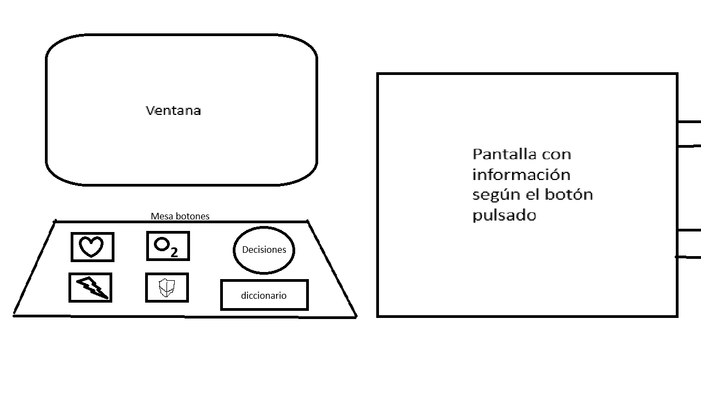

# Diseño del juego: Supervivencia en Marte

Reglas del juego tal y como las ha definido el equipo. El catálogo de eventos está en [eventos.md](eventos.md) y cómo se implementa en Godot, en [../godot/arquitectura.md](../godot/arquitectura.md).

> **Dónde están las cifras de verdad:** en [`game/Data/events.json`](../../game/Data/events.json), que es lo que carga el juego. Este documento explica las reglas; si un número no coincide, manda `events.json` (y hay que corregir aquí). Lo que aún no está decidido está en [Decisiones pendientes](#decisiones-pendientes).

## Idea

Juego cooperativo y educativo para **4 jugadores** en una partida de unos **30 minutos**. La tripulación vive en una base en Marte, cerca del cráter Jezero, y tiene que sobrevivir un número fijo de días marcianos (*Sols*) mientras completa objetivos científicos. Cada evento se basa en una misión o un dato real de la NASA.

- **Pantalla principal (Godot):** muestra el evento, los recursos de la base y el resultado.
- **Móviles:** cada jugador tiene un rol y elige opciones. También se pueden usar etiquetas NFC de herramientas sobre la mesa.
- Se puede jugar con **1 a 4 jugadores**: nunca puede quedar bloqueada una decisión por un rol que no está.

### Boceto de la pantalla principal



- **Ventana**: la vista del exterior de la base.
- **Mesa de botones**: los cuatro recursos (salud, oxígeno, energía, integridad), **Decisiones** y **Diccionario** (el [Libro de tecnicismos](#libro-de-tecnicismos)).
- **Pantalla de información**: muestra el detalle del botón pulsado.

## Bucle de un Sol

El tiempo avanza **por turnos**: un evento principal por Sol y sin reloj, para que haya debate. Solo las emergencias tienen cuenta atrás (20 s).

```text
INICIO DEL SOL ──► SELECCIÓN DEL EVENTO ──► DECISIÓN ──► RESOLUCIÓN ──► FIN DEL SOL ──┐
      ▲                                                                              │
      └──────────────────────────────── (si la partida sigue) ───────────────────────┘
```

| Fase | Qué pasa |
|---|---|
| **Inicio del Sol** | Avanza el contador de Sol. Consumo pasivo: −5 Oxígeno (hasta completar MOXIE). Se aplican los efectos de eventos persistentes y los efectos diferidos que tocan hoy. Se consulta la API de clima espacial: si hay llamarada, salta el [evento en tiempo real](#evento-en-tiempo-real-alerta-solar). |
| **Selección del evento** | Se elige un evento válido según sus condiciones (cadenas de objetivos o aleatorios). Se desbloquean sus términos en el [Libro de tecnicismos](#libro-de-tecnicismos). |
| **Decisión** | Se muestran título, descripción, dato NASA y opciones. Los jugadores votan o decide el rol indicado. Se puede [pedir ayuda a la Tierra](#pedir-ayuda-a-la-tierra). |
| **Resolución** | Se aplican los efectos inmediatos, se programan los diferidos y se muestra el texto de resultado. |
| **Fin del Sol** | Se comprueba la derrota (algún recurso a 0) y la victoria (último Sol). |

## Roles

| Rol (id en el código) | Nombre en pantalla | En qué destaca (según los eventos) |
|---|---|---|
| `engineer` | Ingeniero | Hardware, paneles, rover, sensores, MOXIE. Es el rol con más opciones propias. |
| `biologist` | Bióloga | Invernadero, cultivos, probióticos. |
| `doctor` | Médico | Salud, botiquín, estrés. |
| `generalist` | Comandante / Polivalente (ver [pendientes](#decisiones-pendientes)) | Moral del equipo, órdenes difíciles, comunicaciones con la Tierra. |

Los ids en inglés son los del [contrato de mensajes](../protocol.md) y los de `events.json`. Cada opción de un evento es de dos tipos:

- **Votación general** (`role: null`): votan todos los presentes.
- **Opción de rol** (`role: "engineer"`…): solo puede elegirla ese rol. **Solo se ofrece si ese rol está en la partida.** Todo evento tiene al menos una opción de votación general, para que siempre se pueda avanzar.

## Recursos de la base

Cuatro barras de 0 a 100. Empiezan en 80. **Si cualquiera llega a 0, se pierde la partida.**

| Recurso | Id | Notas |
|---|---|---|
| Energía | `energy` | Baterías y paneles solares. |
| Oxígeno | `oxygen` | Pierde **5 por Sol** de forma pasiva hasta que MOXIE está terminado. |
| Integridad | `integrity` | Estado de la estructura y los equipos. |
| Salud | `health` | Salud de la tripulación. Objetivo extra: no bajar nunca del 50 %. |

## Victoria y derrota

- **Derrota:** cualquier recurso llega a 0.
- **Victoria:** sobrevivir hasta el último Sol (**30** en `events.json`). La puntuación depende de cuántos objetivos se completan.

## Objetivos

| Objetivo | Qué hay que hacer | Recompensa | En `events.json` |
|---|---|---|---|
| **Red de sensores sísmicos** (misión InSight) | Fabricar y colocar 3 sensores. | Si están colocados antes del **Sol 20**, el terremoto avisa con un Sol de antelación. | Sí (`sensors`) |
| **Generador de oxígeno MOXIE** | Completar las fases de montaje hasta el 100 %. | Desaparece el consumo pasivo de oxígeno. | Sí (`moxie`) |
| **Tripulación sana** | Mantener la salud por encima del 50 % toda la partida. | Cuenta para la puntuación. | No |
| **Colonia estable** | Cultivar con éxito 3 cosechas. | Cuenta para la puntuación. | No |
| **Rescate del rover** | Liberar el rover atrapado en las dunas. Inspirado en el rover Spirit, atrapado en arena blanda en 2009. | Cuenta para la puntuación. | No (solo el evento `rover-stuck`) |

## Mecánicas de los eventos

| Mecánica | Ejemplo | Campo en `events.json` |
|---|---|---|
| **Efectos inmediatos** | −10 Oxígeno | `effects` |
| **Efectos diferidos**: se aplican dentro de N Sols | Comerse los brotes: −10 Oxígeno al Sol siguiente | `delayed_effects` |
| **Evento persistente**: si se pospone, castiga cada Sol | Barrigas espaciales: −5, −5 y −10 Salud | `persistent`, `decay`, `defer` |
| **Azar** | 50 % de encontrar una roca especial (+10 Energía) | `chance_effects` |
| **Progreso de objetivo** | +33 % de MOXIE | `progress` |
| **Eventos encadenados** | Montar los sensores con cinta provoca un fallo después | `triggers_event`, `condition`, `reopen_event` |
| **Herramienta NFC**: la opción se puede activar con una etiqueta | Escudos magnéticos | `nfc_tool` |

Como máximo puede haber **2 eventos pendientes** a la vez (`max_pending_events`).

## Tripulación fuera de la base

Cada opción deja ocupado a quien la hace durante 0, 1 o 2 Sols (`away_sols` en `events.json`). Las duraciones por opción están en [tiempos_fuera.md](tiempos_fuera.md).

- **Opción de un rol:** ese astronauta queda ocupado `away_sols` Sols. Con 1 Sol no está disponible mañana y vuelve pasado mañana.
- **Salida grupal («para todos» con `away_sols`):** toda la tripulación queda ocupada y la base se queda vacía. Solo se puede elegir si los 4 están en la base. «Dos salidas» no ocupa a nadie hoy, pero mañana deja a todos ocupados (`away_all` en el efecto diferido).
- **Mientras está ocupado** (haya salido bien o mal la tarea) el astronauta no puede participar: sus opciones de rol se bloquean y su móvil muestra «You are busy!».
- **Base vacía:** al empezar un Sol, si los 4 están ocupados no se genera ningún evento. Se aplica el consumo diario normal y se avisa con un mensaje; el día pasa al pulsar Continue.
- **Vuelve** al empezar el Sol indicado, con un aviso en las noticias del amanecer y el sonido de la puerta.
- **Avatares:** la franja inferior derecha de la cabina muestra a los 4 astronautas con su casco (amarillo, verde, rojo y blanco): con color y «READY» en la base, grises y «BUSY - N Sols» si están ocupados.

## Qué se ve dónde

| Dónde | Qué muestra |
|---|---|
| Pantalla derecha de Godot | Información del evento: título, descripción, dato NASA, pista de la Tierra y resultado de la decisión. **No muestra las opciones.** |
| Móvil de cada jugador | Las opciones de su rol y las de todos, con sus costes. Las bloqueadas salen apagadas con el motivo. |

Hasta que haya móviles, `Phone (debug)` en la ventana de Marte abre un simulador con las mismas opciones. `TurnManager.controller_view_for(role)` prepara lo que recibirá cada mando y `submit_choice_from(role, eventId, optionId)` valida su elección. Las opciones llevan además de `id` y `label` los campos opcionales `detail` (costes), `disabled` y `reason`, ya recogidos en `docs/protocol.md`. Con móviles reales, `PhoneBridge` envía esas vistas y valida las elecciones (ver [../godot/red.md](../godot/red.md)).

## Pedir ayuda a la Tierra

Se basa en el retraso real de las comunicaciones: entre 4 y 24 minutos por mensaje entre Marte y la Tierra, según la distancia.

- Se puede usar sobre cualquier evento sin resolver. **La radio se recarga cada 4 Sols** (`GameState.EARTH_HELP_COOLDOWN_SOLS`): tras pedir ayuda, hay que esperar 4 Sols para volver a pedirla (como mucho 5 ayudas en una partida de 20 Sols). Se eligió 4 y no 3 para que sea una pista valiosa y no un botón de uso diario; con el mensaje lento (2 Sols) la radio vuelve a estar lista 2 Sols después de recibir la respuesta.
- El evento pasa a **«Esperando a la Tierra»** y la respuesta llega **entre 2 y 3 Sols** después. Mientras tanto, el evento sigue aplicando su castigo si lo tiene.
- Según `events.json`, la respuesta **descarta una opción mala** del evento (`earth_discard` indica cuál).
- Opciones previstas en el diseño:
  1. **Enviar el informe completo** (Comandante): −5 Energía. La respuesta llega antes.
  2. **Enviar un mensaje rápido** (votación): sin coste. La respuesta tarda más.
  3. **Cancelar y decidir vosotros** (votación): no se puede volver a pedir ayuda sobre ese evento ese Sol.
- **Dato real:** la API Horizons de JPL da la distancia Tierra–Marte del día. Godot puede mostrar: *«Hoy Marte está a X millones de km; vuestra señal tardará Y minutos en llegar a Houston»*. Si no hay conexión, se usan 225 millones de km y 12 minutos.
- Durante una alerta solar no se puede pedir ayuda.

## Evento en tiempo real: alerta solar

- Al empezar cada Sol se consulta la API DONKI de la NASA (llamaradas solares o eyecciones de masa coronal recientes).
- Si hay una llamarada de clase M o X, el juego **interrumpe el turno** con un evento especial que muestra la fecha real: *«📡 ¡Dato en vivo de la NASA! El [fecha] el Sol lanzó una llamarada que acaba de alcanzar Marte.»*
- Durante ese Sol y el siguiente: no se puede pedir ayuda a la Tierra y sube la radiación. Hay que proteger a la tripulación con probióticos (Bióloga) o escudos (Ingeniero).
- Debe haber un botón de depuración para simular la llamarada sin depender de la API.

## Libro de tecnicismos

Glosario educativo. Cuando aparece un evento con términos técnicos (Sol, MOXIE, cráter Jezero, regolito, eyección de masa coronal, probióticos…), se desbloquean y los jugadores pueden consultarlos desde un botón, sin pausar la partida. Cada término tiene un título, una definición sencilla para estudiantes y un dato de la NASA. Al desbloquear uno aparece un aviso: *«Nuevo término en el Libro de tecnicismos»*.

## APIs de la NASA

La demo debe funcionar **sin Internet**: cada API tiene un dato de respaldo.

| API | Para qué | Sin conexión |
|---|---|---|
| [DONKI](https://api.nasa.gov/) (`/DONKI/FLR`, `/DONKI/CME`) | Alerta solar en tiempo real | No hay alerta (o botón de depuración) |
| [JPL Horizons](https://ssd.jpl.nasa.gov/api/horizons.api) | Distancia Tierra–Marte en la ayuda de la Tierra | 225 millones de km, 12 minutos |
| [Mars Rover Photos](https://api.nasa.gov/) (`/mars-photos/.../perseverance/latest_photos`) | Fotos reales en la intro y en el rover atrapado | Imágenes incluidas en el juego |
| [InSight Weather](https://api.nasa.gov/insight_weather/) / datos MEDA | Racha de viento: +5 Energía en «Polvo en los paneles» | Sin bonificación |

Usad un tiempo de espera corto (3 s) para no bloquear la partida.

## Decisiones pendientes

Al pasar los PDF a Markdown han aparecido contradicciones. Hay que decidir cada una y actualizar este documento y `events.json`.

Fuentes que se comparan: **clases** (PDF «Clases Godot»), **eventos** (PDF «Eventos / Games») y **especificaciones** (el antiguo `docs/especificaciones.md`). Su contenido está ya integrado en `juego/` y `godot/`, y los originales siguen en el historial de git.

| Tema | Lo que dice cada fuente | En `events.json` |
|---|---|---|
| **Duración de la partida** | 15 Sols (clases), 20 Sols (especificaciones), 30 Sols (eventos) | `max_sols: 30` |
| **Nombre del 4.º rol** | Comandante (diseño); `generalist`, que el mando muestra como «Polivalente» | `generalist` |
| **Salud** | Una barra común (especificaciones) o una barra por astronauta (clases) | Una común (`health`) |
| **Fases de MOXIE** | 4 fases de 25 % (eventos) o 3 de 33 % (especificaciones) | 3 fases (33 + 33 + 34) |
| **Plazo de los sensores** | Antes del Sol 20 (eventos) o del Sol 13 (especificaciones) | Sol 20 |
| **Qué da la ayuda de la Tierra** | Revela la mejor opción, da una pista o descarta una opción | Descarta una opción |
| **Retraso de la ayuda** | 2–3 Sols (eventos) o 1–2 Sols (especificaciones) | 2–3 Sols |
| **Habilidad por rol**: probabilidad de éxito y coste según la destreza (3 = experto, 95 %, ×0,5; 2 = normal, 75 %, ×1; 1 = novato, 45 %, ×1,5) | Solo aparece en las clases | No existe |
| **Objetivos de salud, colonia y rover** | En el diseño | Solo existen `sensors` y `moxie` |
| **Condición de victoria** | Completar al menos 3 de 4 objetivos (clases) o una puntuación por objetivos | Sin definir |
| **Dónde está el rover** | Cráter Jezero o dunas de Rocknest (cráter Gale) | Rocknest |
